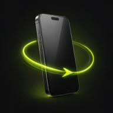
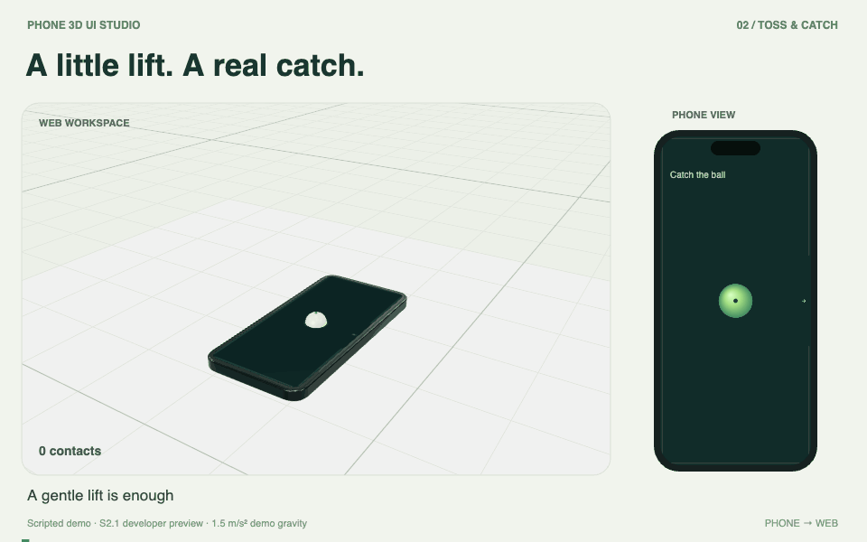
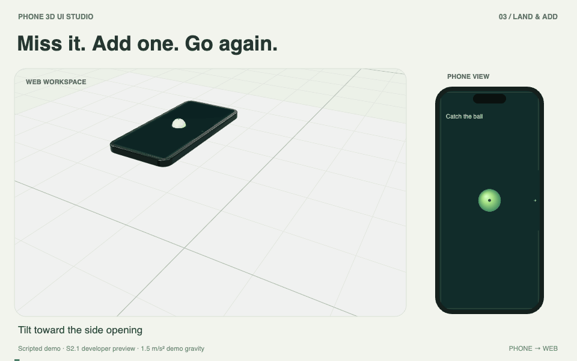
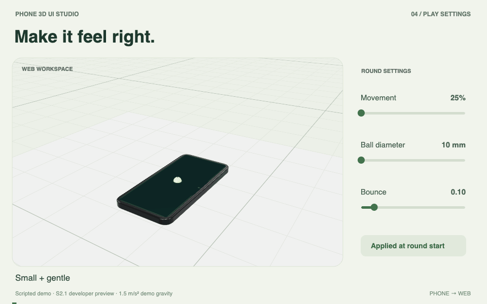

<div align="center">
  
  <h1>Phone 3D UI Studio</h1>
  <p>
    <strong>Interactive 3D iPhone UI presentation studio &amp; spatial Elastic Tray physics prototype.</strong><br />
    Orbit lighting presets and preview any UI recording directly in your browser — or connect a real iPhone over LAN to toss and catch a physical 3D ball across your phone and screen.
  </p>

  <p>
    <strong>English</strong> · <a href="README.zh-CN.md">简体中文</a>
  </p>

  <p>
    <a href="https://popcornnnnnnnn.github.io/phone-3d-ui-studio/"></a>
    <a href="https://github.com/Popcornnnnnnnn/phone-3d-ui-studio/actions/workflows/ci.yml"></a>
    <a href="https://github.com/Popcornnnnnnnn/phone-3d-ui-studio/releases/tag/v0.2.1-alpha.1"></a>
  </p>

  <p>
    
    
    
  </p>

  <p>
    <a href="https://popcornnnnnnnn.github.io/phone-3d-ui-studio/">Live 3D Studio</a> ·
    <a href="#spatial-interaction--in-motion">Spatial Demo</a> ·
    <a href="#try-in-browser">Try in Browser</a> ·
    <a href="#run-locally-mac--iphone-spatial-preview">Run Locally</a> ·
    <a href="#play-settings">Play Settings</a>
  </p>
</div>

---

## Spatial interaction — in motion

A preview of the **S2.1 Elastic Tray** experience: a real iPhone becomes a physical tray in a shared Web 3D world — lift the phone to toss a ball off the screen, move to catch it, and tap **Add ball** on your phone after a miss.



<table>
<tr>
<td width="50%"><strong>Your phone, in space</strong><br />Translation and rotation in a shared 3D workspace.</td>
<td width="50%"><strong>Miss it. Add one. Go again.</strong><br />A new active ball; the old ball remains on the ground.</td>
</tr>
<tr>
<td><a href="docs/media/spatial-movement.gif"></a></td>
<td><a href="docs/media/land-and-add.gif"></a></td>
</tr>
</table>

### Tune the physics feel

Adjust movement scale, ball diameter, and bounce. Each preset below starts a new round, matching **Apply & restart** in the live studio.



> **Render note:** These animations are **scripted renders** driven by the project's procedural phone model and Rapier physics to illustrate interaction behavior; they are not camera footage or wireless reliability evidence ([media details and limitations](docs/media/README.md)).

---

## Try in browser

Open the **[Live Web 3D Studio](https://popcornnnnnnnn.github.io/phone-3d-ui-studio/)** — no Xcode or iPhone required:

- Switch between **Daylight**, **Obsidian**, **Pearl**, and studio lighting presets.
- Orbit, zoom, and inspect front/rear/calibration views of the procedural 3D iPhone 17 model.
- Drop in any local screen-recording clip (**Local video**) to preview your UI inside the 3D scene in real time.

*(Live spatial ball-tossing and low-latency screen mirroring connect to a physical iPhone over the local Mac bridge below.)*

---

## Run locally (Mac + iPhone spatial preview)

> **Developer preview status:** Running the live iPhone companion requires a Mac with **Node.js 24+**, **Xcode 27**, your own iOS signing team, and a physical iPhone on **iOS 27**. No App Store / TestFlight build is included, and wireless interruption/physical acceptance remains in progress.

```sh
npm ci
npm start
```

Open the **Studio ready** URL printed in your terminal (typically <http://127.0.0.1:4317/?experience=marble>). `npm start` launches both the WebSocket bridge and Vite server together; **Ctrl+C stops both**.

A procedural iPhone 17 model is included out of the box. Any privately licensed GLB under `public/local-assets/` is optional and excluded from redistribution.

- [Preview release (`v0.2.1-alpha.1`)](https://github.com/Popcornnnnnnnn/phone-3d-ui-studio/releases/tag/v0.2.1-alpha.1) · [Spatial PR #21](https://github.com/Popcornnnnnnnn/phone-3d-ui-studio/pull/21)
- [中文首次安装指南](docs/QUICKSTART.zh-CN.md) · [iPhone build details](ios/README.md) · [Release readiness](docs/RELEASE_READINESS.md)

---

## Play settings

In **Marble → Play settings**:

| Setting | Default | Range |
| --- | --- | --- |
| Movement scale | 50%: real 20 cm → virtual 10 cm | 25–100% |
| Ball diameter | 15 mm | 10–20 mm |
| Bounce | 0.35 | 0–0.8 |

Click **Start round**, or **Apply & restart** after editing, while tracking is ready. This recalibrates and clears previous balls while retaining the observation camera. The bridge owns round parameters so the phone and browser stay synchronized; rotation stays 1:1, and S1 **Tracking** keeps metric 1:1 translation.

One ball is active and up to five balls are retained including ground traces. The bridge steps Rapier at 120 Hz (`1.5 m/s²` demo gravity) and both screens render snapshots through a 50 ms presentation buffer.

---

## Development and verification

```sh
npm run check
swift test --package-path ios
```

`npm run bridge` and `npm run dev` can also run separately, or on custom ports:

```sh
PHONE_STUDIO_PORT=17317 PHONE_BRIDGE_PORT=17319 PHONE_BRIDGE_FRAME_PORT=17320 npm start
```

Set the iPhone app's `LiveBridgeURL` to your Mac's LAN IP and bridge port on a trusted local network. Camera frames stay on the iPhone in spatial mode. Automated/synthetic tests do not establish physical tracking accuracy or five-minute wireless stability ([experience and evidence](docs/ELASTIC_TRAY.md)).

- [Product goal](docs/PRODUCT_GOAL.md) · [Architecture](docs/ARCHITECTURE.md) · [Roadmap](ROADMAP.md) · [Issues](https://github.com/Popcornnnnnnnn/phone-3d-ui-studio/issues)
