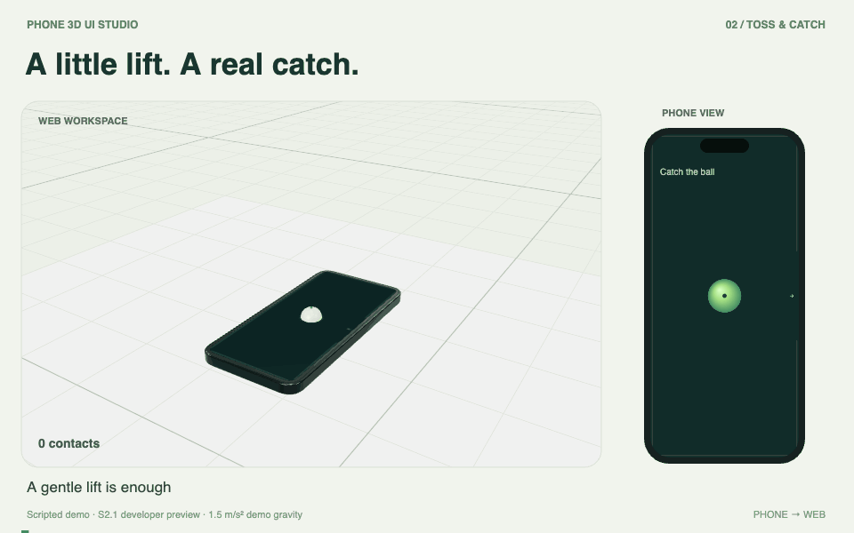
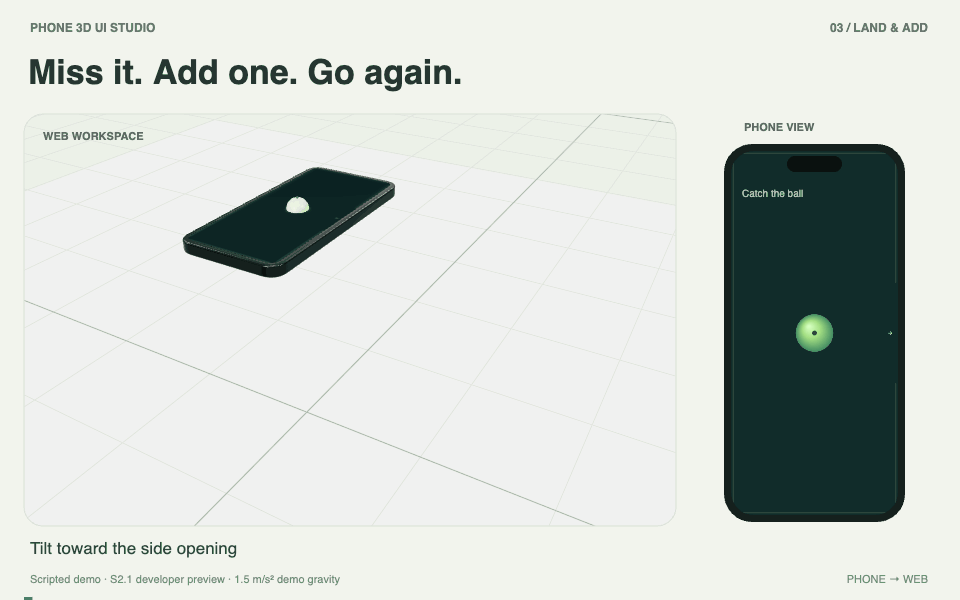
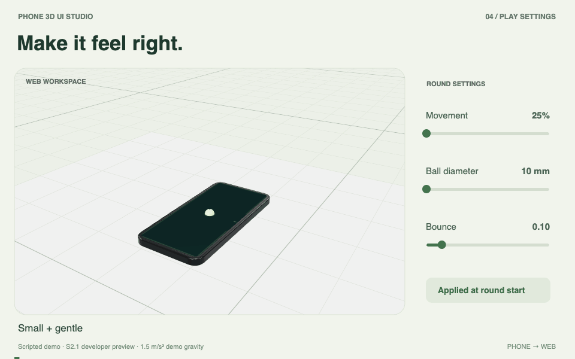

# Phone 3D UI Studio

A real iPhone becomes a tray in a shared Web 3D world. Gently toss a ball, move to catch it, and tap **Add ball** on your phone after a miss.

**Developer preview.** A native Mac host now bundles the desktop workspace, with a QR connection panel and an embedded Web 3D renderer. The locally built Mac app is ad-hoc signed; public signing/notarization and independent-machine acceptance remain open. Playing still requires Xcode 27, your own iPhone signing and a physical iPhone on iOS 27. No TestFlight invitation is included. Wireless physical acceptance remains open.

## Native Mac preview

On an Apple Silicon Mac with Xcode tools, Node 24+ and installed npm dependencies:

```sh
npm run app:build
open "build/macos/Phone 3D Studio.app"
```

The app contains its own runtime, starts an isolated local session, and closes it on quit. Click **Connect iPhone**, then **Mac connection → Scan QR code** in the updated iPhone app. Pair again after restarting the Mac session. iPhone 17, 16 and 16 Plus have shared geometry profiles; physical validation remains pending. Unknown hardware is labeled as a fallback.

[Mac 安装、配对与验证边界](docs/MAC_APP.zh-CN.md)

## Spatial interaction — in motion

A preview of the new **S2.1 Elastic Tray** experience: move a phone through space, gently toss a ball, catch it, and add a new one after a miss.

These are **scripted renders**, using the project's original phone model and Rapier physics. The phone inset is a projected view of the same world state. They illustrate the interaction; they are not camera footage, a live network recording, or wireless reliability evidence.

**Try the developer preview:** [S2.1 release](https://github.com/Popcornnnnnnnn/phone-3d-ui-studio/releases/tag/v0.2.1-alpha.1) · [Setup guide](https://github.com/Popcornnnnnnnn/phone-3d-ui-studio/blob/v0.2.1-alpha.1/docs/QUICKSTART.zh-CN.md) · [Spatial implementation](https://github.com/Popcornnnnnnnn/phone-3d-ui-studio/pull/21)

### A little lift. A real catch.

The tray's movement supplies the energy. The same ball leaves the screen, rises through the Web world, and makes contact with the tray again.



<table>
<tr>
<td width="50%"><strong>Your phone, in space</strong><br />Translation and rotation in a shared 3D workspace.</td>
<td width="50%"><strong>Miss it. Add one. Go again.</strong><br />A new active ball; the old ball remains on the ground.</td>
</tr>
<tr>
<td><a href="docs/media/spatial-movement.gif"></a></td>
<td><a href="docs/media/land-and-add.gif"></a></td>
</tr>
</table>

### Make it feel right

Adjust movement scale, ball diameter, and bounce. Each preset below starts a new round, just as **Apply & restart** does in the app.



[Media details and limitations](docs/media/README.md)

---

- GitHub repository: <https://github.com/Popcornnnnnnnn/phone-3d-ui-studio>
- Delivery board: <https://github.com/users/Popcornnnnnnnn/projects/3>

## Start the desktop workspace

Use Node.js **24+** on a Mac:

```sh
npm ci
npm start
```

Open the **Studio ready** URL printed in the terminal, normally <http://127.0.0.1:4317/?experience=marble>. This starts both the bridge and Web server; **Ctrl+C stops both**. Occupied ports produce an explanation without stopping another instance.

A procedural phone model is included. The privately licensed GLB under `public/local-assets/` is **optional** and never redistributed.

[中文首次安装指南](docs/QUICKSTART.zh-CN.md) · [iPhone build details](ios/README.md) · [Release readiness](docs/RELEASE_READINESS.md)

## Play settings

In **Marble → Play settings**:

| Setting | Default | Range |
| --- | --- | --- |
| Movement scale | 50%: real 20 cm → virtual 10 cm | 25–100% |
| Ball diameter | 15 mm | 10–20 mm |
| Bounce | 0.35 | 0–0.8 |

Click **Start round**, or **Apply & restart** after editing, while tracking is ready. This recalibrates and clears previous balls while retaining the observation camera. The bridge owns the parameters for that round; the phone and every browser use its snapshots. Another page cannot change a running controller's round. Rotation stays 1:1; the S1 **Tracking** mode retains metric 1:1 translation.

One ball is active and at most five balls are retained including ground traces. The bridge runs Rapier at 120 Hz; both screens render snapshots with a 50 ms presentation buffer. Demonstration gravity is 1.5 m/s². Real tray motion supplies energy; no automatic launch, Return or recovery teleport is used.

## Development and verification

```sh
npm run check
swift test --package-path ios
```

`npm run bridge` and `npm run dev` remain available separately. For an isolated instance:

```sh
PHONE_STUDIO_PORT=17317 PHONE_BRIDGE_PORT=17319 PHONE_BRIDGE_FRAME_PORT=17320 npm start
```

Use the printed Web URL, which includes the selected bridge. Set the iPhone's `LiveBridgeURL` to that Mac's LAN address and bridge port before building. Web is loopback-only; the phone communicates with the LAN bridge. Use a trusted local network; the prototype has no authenticated pairing or cloud access.

Camera images stay on the iPhone in spatial mode. Automated/synthetic tests do not establish physical accuracy, visible latency or five-minute wireless reliability. See [experience and evidence](docs/ELASTIC_TRAY.md).

**Spatial interaction is the main track.** Screen mirroring, image quality and transport performance remain a supporting track. Choose **Screen mirroring** on both devices for the prior workflow. [Product goal](docs/PRODUCT_GOAL.md) · [Architecture](docs/ARCHITECTURE.md) · [Roadmap](ROADMAP.md). Previous plans remain under `docs/legacy/` and `experiments/`.


<!-- workspace-maintenance:start -->
## 维护与问题入口

代码与必要文档沿用 [GitHub 仓库](https://github.com/Popcornnnnnnnn/phone-3d-ui-studio)；需跟进的问题统一从 [Issues](https://github.com/Popcornnnnnnnn/phone-3d-ui-studio/issues) 接续，先查重，再记录进展与完成条件。
未完成开发的快照保存在 `codex/workspace-backup-20261010` 分支，便于恢复与接续。
项目功能与验收沿用已有记录。
<!-- workspace-maintenance:end -->
