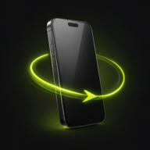
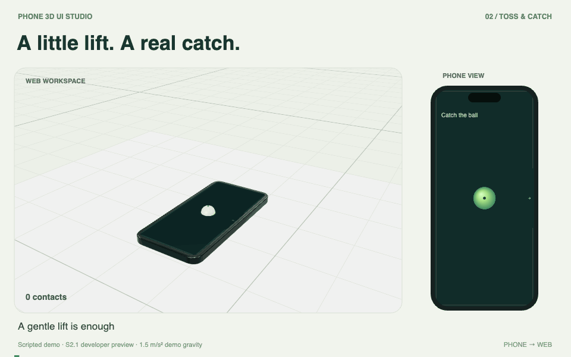
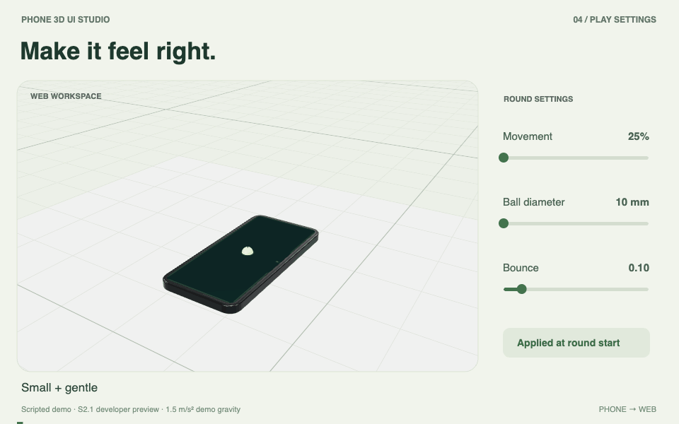

<div align="center">
  
  <h1>Phone 3D UI Studio</h1>
  <p>
    <strong>可交互的 3D iPhone UI 展示工作室与空间物理交互原型（Elastic Tray）。</strong><br />
    直接在浏览器中调整 3D 灯光预设并预览任意录屏视频，或连接真机体验手机与桌面共享三维世界中的抛球与接球。
  </p>

  <p>
    <a href="README.md">English</a> · <strong>简体中文</strong>
  </p>

  <p>
    <a href="https://popcornnnnnnnn.github.io/phone-3d-ui-studio/"></a>
    <a href="https://github.com/Popcornnnnnnnn/phone-3d-ui-studio/actions/workflows/ci.yml"></a>
    <a href="https://github.com/Popcornnnnnnnn/phone-3d-ui-studio/releases/tag/v0.2.1-alpha.1"></a>
  </p>

  <p>
    <a href="https://popcornnnnnnnn.github.io/phone-3d-ui-studio/">在线 3D 工作室</a> ·
    <a href="#空间交互演示">空间演示</a> ·
    <a href="#浏览器在线体验">在线体验</a> ·
    <a href="#本地运行mac--iphone-空间预览">本地运行</a> ·
    <a href="#手感参数">手感参数</a>
  </p>
</div>

---

## 空间交互演示

下面是 **S2.1 Elastic Tray** 体验：真实 iPhone 会成为共享 Web 三维世界中的一个物理托盘——轻轻抬起手机抛起小球、移动去接住它；没接住时，在手机上点击 **Add ball** 继续。



<table>
<tr>
<td width="50%"><strong>空间中的手机</strong><br />在共享三维空间中移动和旋转。</td>
<td width="50%"><strong>没接住？再加一个继续</strong><br />添加新的活动小球，旧球仍留在地面上。</td>
</tr>
<tr>
<td><a href="docs/media/spatial-movement.gif"></a></td>
<td><a href="docs/media/land-and-add.gif"></a></td>
</tr>
</table>

### 调到合适的手感

可以调整移动比例、小球直径和弹性。下面的每个预设都会像应用中的 **Apply & restart** 一样开始新一轮游戏。



> **渲染说明：** 这些动图是基于项目程序化手机模型和 Rapier 物理引擎的**脚本渲染**，用于展示交互设计，并非真机实拍或无线可靠性证明（详见[媒体说明与限制](docs/media/README.md)）。

---

## 浏览器在线体验

直接打开 **[在线 3D 工作室](https://popcornnnnnnnn.github.io/phone-3d-ui-studio/)**，无需 Xcode 或真机即可体验：

- 切换 **Daylight**、**Obsidian**、**Pearl** 等工作室灯光与背景预设。
- 自由旋转、缩放，查看程序化 3D iPhone 17 参考模型的正面、背面与校准视角。
- 选择本地录屏视频（**Local video**），即时在 3D 手机屏幕上预览你的界面演示。

*(实时的 6DoF 空间抛球与低延迟真机投屏需要运行下方的本地 Mac 桥接服务并连接 iPhone。)*

---

## 本地运行（Mac + iPhone 空间预览）

> **开发者预览状态：** 完整的真机空间联动需要 Mac（**Node.js 24+**、**Xcode 27**）、个人 iOS 签名团队以及运行 **iOS 27** 的真机。当前不含 App Store 或 TestFlight 安装包，无线稳定性与实体验收仍在推进中。

```sh
npm ci
npm start
```

打开终端打印的 **Studio ready** 地址（通常为 <http://127.0.0.1:4317/?experience=marble>）。该命令会同时启动桥接服务与 Web 前端；按 **Ctrl+C** 同时停止。

- [预览版本 (`v0.2.1-alpha.1`)](https://github.com/Popcornnnnnnnn/phone-3d-ui-studio/releases/tag/v0.2.1-alpha.1) · [空间交互 PR #21](https://github.com/Popcornnnnnnnn/phone-3d-ui-studio/pull/21)
- [中文首次安装指南](docs/QUICKSTART.zh-CN.md) · [iPhone 构建说明](ios/README.md) · [发布就绪状态](docs/RELEASE_READINESS.md)

---

## 手感参数

在 **Marble → Play settings** 中可调节：

| 参数 | 默认值 | 范围 |
| --- | --- | --- |
| Movement scale | 50%：真实移动 20 cm → 虚拟 10 cm | 25–100% |
| Ball diameter | 15 mm | 10–20 mm |
| Bounce | 0.35 | 0–0.8 |

本地桥接以 120 Hz 运行 Rapier 物理（演示重力 `1.5 m/s²`），最多同时保留 5 个小球轨迹。

---

## 开发与验证

```sh
npm run check
swift test --package-path ios
```

- [产品目标](docs/PRODUCT_GOAL.md) · [系统架构](docs/ARCHITECTURE.md) · [路线图](ROADMAP.md) · [Issues](https://github.com/Popcornnnnnnnn/phone-3d-ui-studio/issues)
