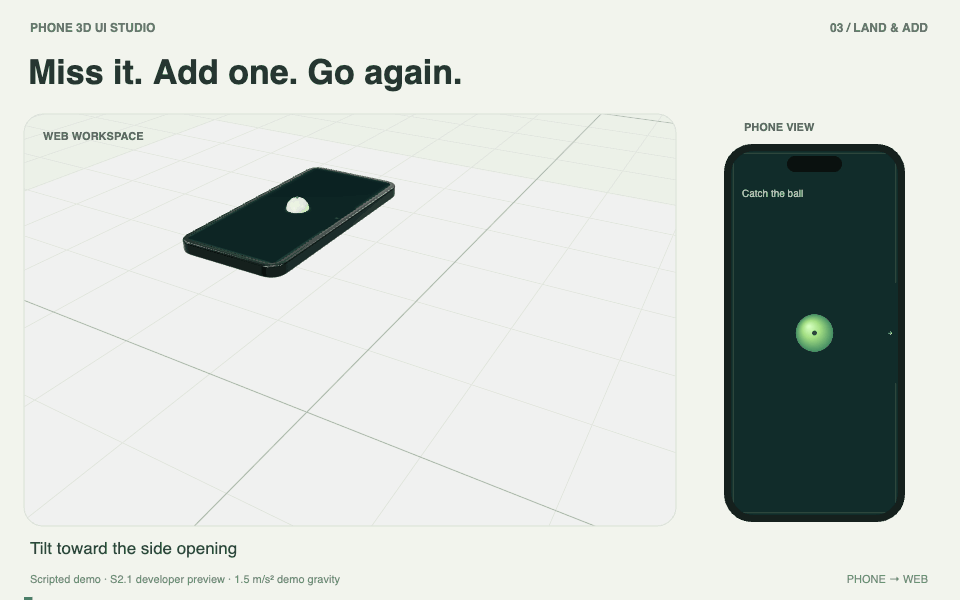

<div align="center">
  
  <h1>Phone 3D UI Studio</h1>
  <p>
    <strong>零安装在线 3D iPhone UI 展台与 Elastic Tray 物理游乐场 —— 同时保留本地 Mac + ARKit 6DoF 空间交互（Pro）。</strong><br />
    手机打开即玩单机模式，桌面扫码即可用手机陀螺仪通过 WebRTC 实时操控，也可直接在浏览器中预览交互式 3D UI。
  </p>

  <p>
    <a href="README.md">English</a> · <strong>简体中文</strong>
  </p>

  <p>
    <a href="https://phone3d.popcornnn.xyz"></a>
    <a href="https://github.com/Popcornnnnnnnn/phone-3d-ui-studio/actions/workflows/ci.yml"></a>
    <a href="https://github.com/Popcornnnnnnnn/phone-3d-ui-studio/releases/tag/v0.2.1-alpha.1"></a>
  </p>

  <p>
    <a href="https://phone3d.popcornnn.xyz">在线游玩</a> ·
    <a href="#零安装在线游乐场web-playground">在线游乐场</a> ·
    <a href="#空间交互演示">空间演示</a> ·
    <a href="#本地-arkit-6dofpro与原生-mac-预览">本地 Pro 模式</a> ·
    <a href="#开发与验证">开发与验证</a>
  </p>
</div>

---

## 零安装在线游乐场（Web Playground）

直接打开 **[phone3d.popcornnn.xyz](https://phone3d.popcornnn.xyz)**，无需 Xcode 或安装任何 App：

- **桌面在线游玩（Play Online）：** 拖动 **Tilt Pad**（或使用方向键/`WASD` 倾斜、`Space` 抛球、`B` 补球、`R` 重置），由浏览器端 **120 Hz Rapier WASM 物理引擎**（`shared/marbleWorld.mjs`）实时驱动。
- **手机扫码配对（`?pair=<CODE>`）：** 用 iPhone 或 Android 手机浏览器扫描页面上的二维码，通过 **3DoF 陀螺仪姿态**与**上甩加速度抛球**，经 **WebRTC DataChannel**（并支持 `/api/room/:code` WebSocket 中继自动回退）实时控制桌面 3D 手机。
- **精细开源 3D 模型与连接自适应：** 内置轻量 Draco 压缩的 **CC-BY 4.0** 开源硬件模型（**iPhone 17 Pro / Pro Max**、**iPhone 17 / 16 / 16 Plus**、**iPhone 16 Pro / Pro Max**）及参数化 **Android（自适应比例）**旗舰机模型。手机连接时会发送屏幕规格与 Android `userAgentData` 信息（`web-device`），自动切换最接近的 3D 机型和物理尺寸，并支持一键切换 **机型与质感配色**（Obsidian / Silver / Natural / Deep Blue / Sage / Cosmic Orange）。详见 [3D 资产与致谢](docs/ASSETS.md)。
- **手机端单机模式（Solo Mode）：** 手机直接打开网页即可进入全屏 **Elastic Tray** 游玩界面，内置手持姿态校准、触控拖拽回退、Web Audio 音效反馈，并可随时输入 6 位房间码与桌面配对。
- **交互式 3D UI 展台（3D UI Showcase）：** 内置 3 套实时 Canvas2D 交互屏幕（**Audio Deck**、**Weather Card**、**Stack Cards**，配对后可由手机远程控制与倾斜），同时保留 **Local MP4** 本地录屏预览。

### 本地运行与 Cloudflare 部署

```sh
npm ci
npm run dev -- --host 0.0.0.0   # 启动 Vite 开发服务器及 /api/room/:code 房间中继
npm run build:public            # 构建 dist/（base /）并移除私有 public/local-assets/
```

线上部署采用单域名 **Cloudflare Workers Static Assets + Durable Object（`RoomRelay`）**，配置见 [`worker/wrangler.toml`](worker/wrangler.toml) 与 [`worker/src/index.ts`](worker/src/index.ts)，并通过 [`public/.assetsignore`](public/.assetsignore) 排除 `local-assets/`。公开轻量化 GLB 位于 `public/models/`，Draco 解码器自托管于 `public/draco/`。

### 3D 模型开源致谢（CC-BY 4.0）

在线版 iPhone 3D 外壳改制自 Sketchfab 创作者 **Ranguel**、**Zvoni10** 与 **MajdyModels** 的 [CC-BY 4.0](https://creativecommons.org/licenses/by/4.0/) 模型。完整署名链接与改制说明见 [`docs/ASSETS.md`](docs/ASSETS.md)。本项目与 Apple Inc. 无关联。

---

## 空间交互演示

下面展示 **S2.1 Elastic Tray** 体验：轻抬托盘抛起小球，移动或倾斜接住它；没接住时点击 **Add ball** 继续。


<table>
<tr>
<td width="50%"><strong>空间中的手机</strong><br />在共享三维空间中移动和旋转。</td>
<td width="50%"><strong>没接住？再加一个继续</strong><br />添加新的活动小球，旧球仍留在地面上。</td>
</tr>
<tr>
<td><a href="docs/media/spatial-movement.gif"></a></td>
<td><a href="docs/media/land-and-add.gif"></a></td>
</tr>
</table>

> **渲染说明：** 上述动图为基于程序化手机模型和 Rapier 物理引擎的**脚本渲染**，用于展示交互设计，并非真机实拍或无线可靠性证明（详见[媒体说明与限制](docs/media/README.md)）。

---

## 本地 ARKit 6DoF（Pro）与原生 Mac 预览

如需局域网真机 6DoF 空间位移与原生 ScreenCaptureKit 投屏：

- **原生 Mac 应用（Apple Silicon）：** `npm run app:build && open "build/macos/Phone 3D Studio.app"`（本地 ad-hoc 签名，参见 [Mac 安装、配对与验证边界](docs/MAC_APP.zh-CN.md)）。
- **本地 Node 桥接 + Vite：** `npm start`（iOS ARKit 6DoF 伴侣构建需 **Node.js 24+**、**Xcode 27** 与 **iOS 27** 个人签名）。
- **文档与架构：** [中文首次安装指南](docs/QUICKSTART.zh-CN.md) · [iPhone 构建说明](ios/README.md) · [产品目标](docs/PRODUCT_GOAL.md) · [空间架构](docs/ARCHITECTURE.md) · [S2.1 验收记录](docs/ELASTIC_TRAY.md)

## 开发与验证

```sh
npm run check
npx tsc -p worker/tsconfig.json --noEmit
swift test --package-path ios
```

- GitHub 仓库：<https://github.com/Popcornnnnnnnn/phone-3d-ui-studio>
- 交付看板：<https://github.com/users/Popcornnnnnnnn/projects/3>
